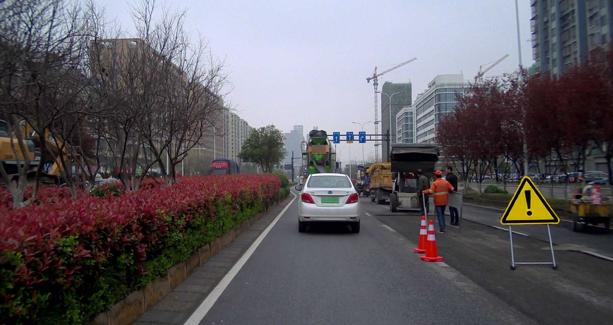
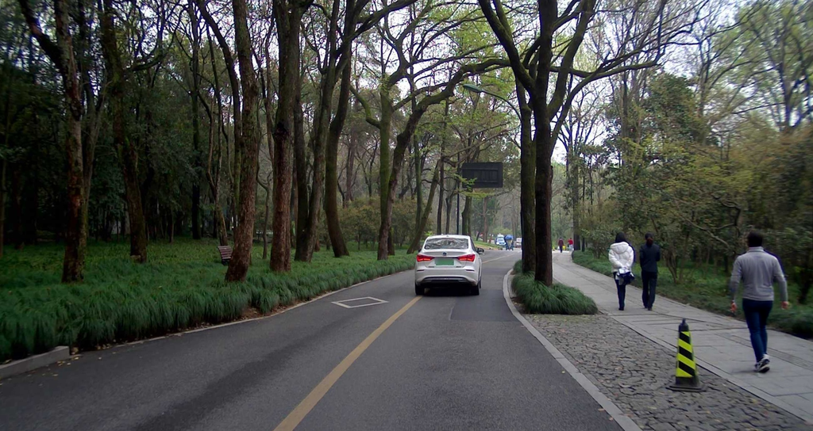
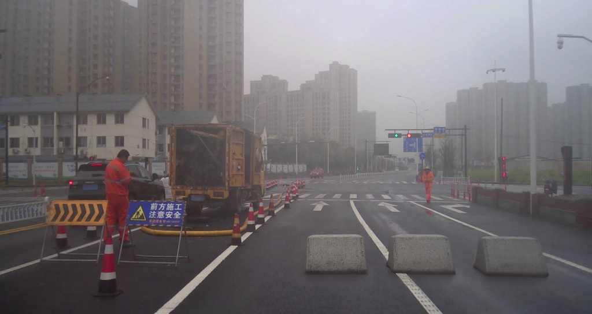
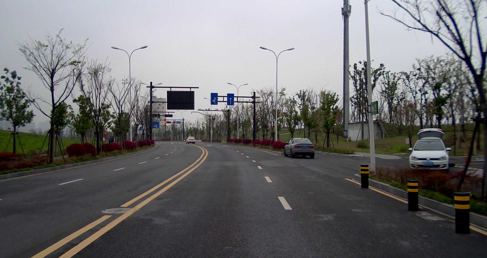

# RoadLab / Diffusion Scarce Gen

面向道路稀缺目标的数据增强工具集。项目从稀缺样本筛选和ComfyUI原型发展为可控物体生成、实验记录及审核导出的RoadLab网页系统。

## 当前功能

| 入口 | 位置与生成路线 |
|---|---|
| 交通锥 | CLRNet R18预测车道，构造遮罩，FLUX Fill结合外部RoadBarrier LoRA |
| 垃圾桶 | 手动接地点或车道几何建议，FLUX Fill基座 |
| 简单警示牌 | 手动矩形，原生Fill条件、采样、解码和ROI合成 |
| 背向行人 | 手动人行道矩形，同一原生路线 |

支持上传、遮罩预览、串行任务、进度、取消、历史查看、实验包及结果标框。输入、执行图、参数、来源哈希和审核意见随任务保存。只有完成且经成员明确通过、具有实际目标框的结果才进入COCO导出。

成排水泥墩、反光柱、石球、施工挡板、背向施工人员和沙袋属于[独立实验](experiments/multi_object)，尚未增加为正式网页入口。生成数据的检测增益仍待独立标注和检测器对照验证。

## 代表结果

| 简单警示牌 | 背向行人 |
|---|---|
|  |  |
| 成排水泥墩实验 | 反光柱实验 |
|  |  |

图片为模型输出的展示样例；[来源和状态](examples/README.md)保留对应案例，不作为独立测试集成功率或人工真值。

## 安装与离线检查

```bash
python -m venv .venv
# Linux/macOS: source .venv/bin/activate
# Windows PowerShell: .venv\Scripts\Activate.ps1
python -m pip install -r requirements.txt
python scripts/run_checks.py
python scripts/export_workflows.py
```

核心安装足以运行CPU测试和导出API图。车道模型另装`requirements/lane.txt`，语义保护另装`requirements/scene.txt`。ComfyUI、模型权重与节点需要单独配置；本仓库不含模型权重、运行环境或LoRA训练材料。

## 启动网页

先完成[部署说明](docs/deployment.md)中的模型、节点和共享输入目录配置，然后运行：

```bash
python roadlab_web/app.py
```

默认打开`http://127.0.0.1:6008`。Linux也可复制`.env.example`为`.env`，配置后执行`bash roadlab_web/start.sh`。`start.sh`以前台运行方式交给终端或服务管理器管理。

无ComfyUI时，页面仍可启动，健康检查会报告未就绪。真正生成需要GPU与外部模型；交通锥路线还需要自行提供已有RoadBarrier LoRA，警示牌和行人路线不依赖该LoRA。

## 目录

```text
roadlab_web/             正式网页、配置、缓存、审核与测试
scripts/filter/         稀缺度筛选与COCO到KITTI 2D标签转换
scripts/LanDetect/      旧UFLD入口和CLRNet R18适配（保留历史目录拼写）
scripts/placement/      早期透视布设工具
workflows/              早期界面工作流、XR工作流、网页API图
experiments/            多物体图准备工具与历史实验记录
requirements/          核心、车道和场景分析依赖
tests/                  冻结执行图和可移植性测试
docs/                   架构、部署、模型、复现及评测口径
```

## 早期工具

```bash
python scripts/filter/scarce_sample_filter.py
python scripts/filter/coda_to_kitti.py
python scripts/LanDetect/detect_lanes.py --help
python scripts/LanDetect/detect_lanes_clrnet.py --help
```

筛选脚本的数据路径在文件末尾配置。COCO到KITTI转换只对应类别与2D框，3D字段为占位值。[工作流格式](workflows/README.md)、[方法与模块](docs/architecture.md)、[中期更新](docs/midterm-progress.md)、[评测口径](docs/evaluation-notes.md)。

## 来源与许可

数据来源：[KITTI](https://www.cvlibs.net/datasets/kitti/)、[CODA](https://coda-dataset.github.io/)。完整数据集请从原发布方获取。

项目自有代码沿用[MIT](LICENSE)。CLRNet快照保留其Apache-2.0许可证；模型和数据的使用分别遵循原发布方条款，详见[第三方说明](THIRD_PARTY_NOTICES.md)。
